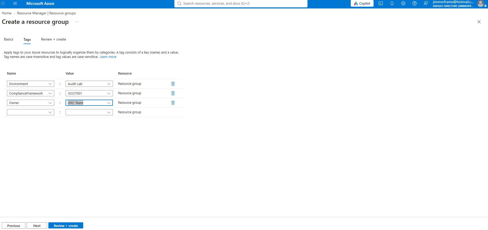
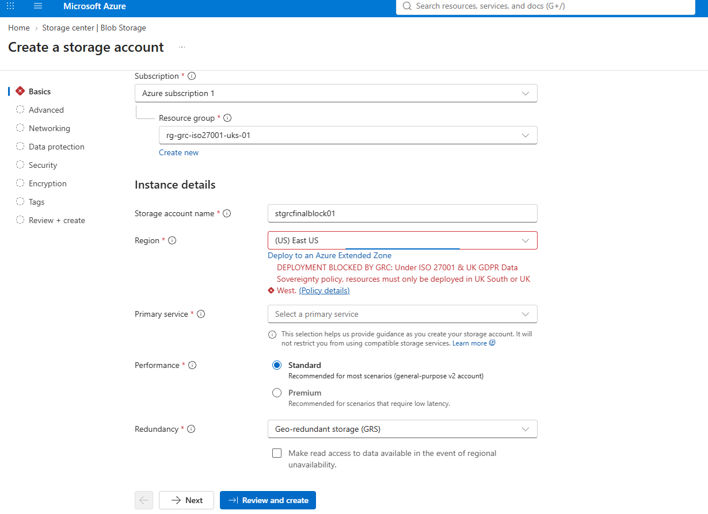
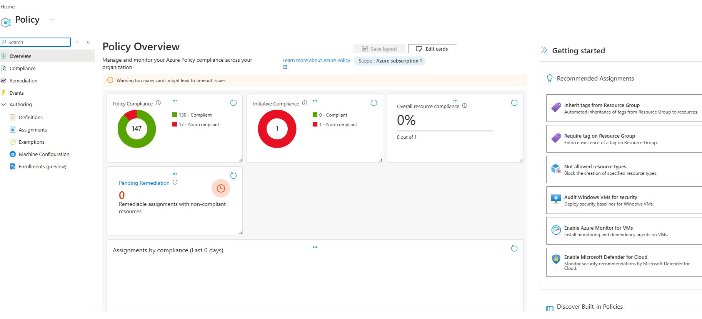
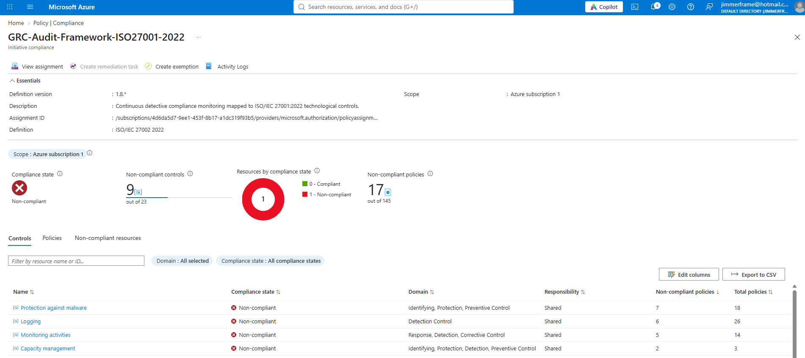

# Azure Cloud GRC: Automated ISO/IEC 27001:2022 & UK GDPR Governance Architecture

## 1. Executive Summary & Business Problem
In modern enterprise cloud environments, relying on manual point-in-time spreadsheet audits creates severe **compliance drift**, unmonitored security exposure, and regulatory liability. When engineering teams provision cloud infrastructure rapidly without automated guardrails, organisations risk accidental data residency violations (deploying UK customer PII into US or EU data centres) or exposing storage assets publicly.

### Project Objective
Design and deploy a governed **Cloud Landing Zone** in Microsoft Azure utilizing **Policy-as-Code** to automate regulatory enforcement across three core Governance, Risk, and Compliance (GRC) pillars:
1. **Asset Inventory & FinOps Governance:** Enforce mandatory metadata tagging at the Resource Group layer to establish clear ownership, audit scope, and cost attribution.
2. **Preventative Control (Hard Guardrail):** Enforce **UK GDPR Data Sovereignty** and **ISO/IEC 27001:2022** geographical restrictions by intercepting and blocking any resource deployment outside of `UK South` or `UK West` at the Azure Resource Manager (ARM) control plane.
3. **Detective Control (Continuous Assurance):** Deploy continuous automated compliance auditing mapped to **ISO/IEC 27001:2022 Annex A controls**, evaluating live resources for security misconfigurations and generating real-time audit evidence.

---

## 2. Governance Architecture & Control Mapping

| Governance Pillar | Control Type | Azure Mechanism | Regulatory Alignment | Enforcement Effect | Operational Purpose |
| :--- | :--- | :--- | :--- | :--- | :--- |
| **Asset & FinOps Governance** | Administrative / Inventory | Resource Manager Metadata Tags | ISO 27001 Control 5.9 (Inventory of Information & Assets) | Taxonomy Tagging | Establishes cost allocation, environment classification, and GRC ownership. |
| **Data Sovereignty Guardrail** | **Preventative Control** | Custom Azure Policy (`Allowed Locations`) | UK GDPR Data Residency & ISO 27001 Compliance | `Deny` | Blocks non-UK infrastructure deployments prior to creation. |
| **Continuous Compliance Monitoring** | **Detective Control** | Policy Initiative (`ISO/IEC 27002:2022`) | ISO/IEC 27001:2022 (23 Control Domains / 145+ Policies) | `Audit` / `AuditIfNotExists` | Continuously evaluates deployed assets and flags security non-conformities. |

---

## 3. Step-by-Step Implementation & Verification

### Phase 1: Scoped Environment & FinOps Metadata Tagging
Before deploying technical controls, proper cloud governance requires structured asset classification. Under **ISO/IEC 27001:2022 (Control 5.9 - Inventory of information and other associated assets)**, every cloud container must have an identifiable owner, operational scope, and regulatory context.

A dedicated Resource Group (`rg-grc-iso27001-uks-01`) was provisioned in **UK South** and assigned three foundational governance tags:
* `Environment` : `Audit-Lab` (Separates compliance testing workloads from production)
* `ComplianceFramework` : `ISO27001` (Identifies the regulatory baseline governing the scope)
* `Owner` : `GRC-Team` (Establishes clear accountability for incident escalation and FinOps cost management)

---

### Phase 2: Preventative Control — Enforcing UK Data Sovereignty (`Deny`)
**The Why:** A detective alert telling a security team that sensitive UK customer data was deployed to a US server *after* the fact still constitutes a reportable data residency breach. Binary compliance mandates like data sovereignty require a **Preventative Control** that makes non-compliant deployment technically impossible.

**The How:** An `Allowed Locations` Azure Policy definition was assigned to the subscription with the enforcement effect set to `Deny`, restricting permitted deployment regions strictly to **UK South** and **UK West**, accompanied by a custom GRC violation message to educate users at the point of failure.

#### Troubleshooting Policy Inheritance & Scope Exclusions
During initial validation testing, a test storage account deployed to `(US) East US` bypassed the policy and provisioned successfully. Rather than assuming simple replication latency, an inspection of the policy assignment architecture revealed a scope configuration issue: the target Resource Group (`rg-grc-iso27001-uks-01`) had been added to the **Exclusions** parameter while the **Scope** remained at the Subscription root—effectively carving out a policy exemption for our test environment.

After removing the Resource Group from the Exclusion block and forcing a policy state evaluation, we attempted to deploy a storage account (`stgrcfinalblock01`) into `(US) East US`. As demonstrated below, the Azure Resource Manager control plane intercepted the request during validation and blocked creation immediately:

---

### Phase 3: Detective Control — Continuous ISO/IEC 27001:2022 Auditing (`Audit`)
**The Why:** Not all security controls should use a `Deny` effect; blocking complex operational configurations outright can break legitimate engineering workflows during deployment. Instead, enterprise GRC teams use **Detective Controls** (`Audit` initiatives) to continuously monitor resource configurations against regulatory frameworks and surface non-conformities on a central dashboard for remediation.

**The How:** We assigned Microsoft's built-in **ISO/IEC 27002:2022** regulatory compliance initiative (`GRC-Audit-Framework-ISO27001-2022`) at the subscription scope. This initiative bundles **145+ individual policy rules** mapped across **23 ISO 27001 control domains**.

#### Simulating Configuration Drift & Capturing Audit Evidence
To test the detective engine, we deployed a storage account (`stgrcauditfail01`) into **UK South** (satisfying our Phase 2 Preventative data residency gate), but deliberately introduced a critical security misconfiguration by enabling **Public Network Access from all networks**.

Once the Azure Policy evaluation cycle completed, the **Policy Overview Dashboard** immediately reflected the compliance state across the subscription—showing **17 non-compliant policy findings** out of 147 total evaluated policies and dropping overall resource compliance to **0%**:

Drilling down into the **GRC-Audit-Framework-ISO27001-2022 Initiative Compliance** blade provides granular, auditor-ready evidence. The engine pinpointed **9 non-compliant ISO 27001 control domains** (out of 23) triggered by our unhardened storage account, specifically flagging failures across:
* **Protection against malware** (7 non-compliant policies — Identifying, Protection, Preventive Control)
* **Logging** (6 non-compliant policies — Detection Control; missing diagnostic storage logging)
* **Monitoring activities** (5 non-compliant policies — Response, Detection, Corrective Control)
* **Capacity management** (2 non-compliant policies — Identifying, Protection, Detection, Preventive Control)

This view enables a GRC Analyst or Security Specialist to export direct CSV audit evidence (`Export to CSV`) or trigger automated `DeployIfNotExists` / `Modify` remediation tasks to close audit findings ahead of external certification assessments.

---

## 4. FinOps Hygiene & Environment Decommissioning
In alignment with FinOps best practices, following verification and evidence capture, the entire `rg-grc-iso27001-uks-01` Resource Group and its child storage resources were cleanly decommissioned via Resource Manager teardown, ensuring zero orphaned cloud assets and **£0.00 ongoing subscription expenditure**.
